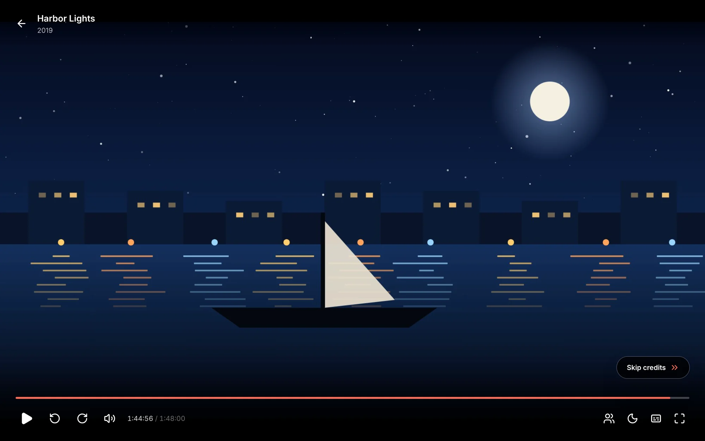

When an episode's end credits start, the [Up next](/docs/watching/playing/#up-next) card shows straight away, so the next episode is one press away instead of waiting for the very end. Matinee finds where the credits start by itself, for episodes and for movies.

## Skip credits

When nothing comes up next, such as at the end of a movie, the player shows **Skip credits** in the bottom corner once the credits start. Press it to finish the video and go back to where you were. The button stays while the credits roll, so you can just as well watch them.

Some films and shows have a scene after the credits. When Matinee sees one, **Skip credits** jumps to that scene instead, and Up next waits until it's over.

Reaching the credits counts as having watched the episode or movie, so it leaves **Continue watching** even if you stop there.

## On phones and TVs

In the [phone and TV apps](/docs/apps/phone-and-tv/), Up next and **Skip credits** show in the same places. On a TV, **Skip credits** is ready for the remote the moment it shows: press select to skip. Any other button works as usual.

## How Matinee finds the credits

You don't need to mark anything. Matinee finds where the credits start in one of three ways:

- **Chapters.** When a file has a chapter called *Credits*, *End Credits*, *Outro* or *End Titles* in its second half, that's where they start.
- **Listening.** Episodes of a season usually end on the same music. Matinee listens to the last part of each episode and looks for the stretch of sound that two episodes have in common, the way it finds [intros](/docs/watching/skipping-intros/).
- **Looking.** End credits are mostly writing on black. For movies, and for episodes that share no music, Matinee looks at the last part of the video for where the picture goes dark and stays dark.

Credits written over the film itself, or a season whose episodes all end differently, may not be found. Then Up next shows 30 seconds before the end, as it always did.

Matinee does this once each file is [analyzed](/docs/server/media-analysis/), at the same gentle pace, after looking for intros, and only once per video. A replaced file is looked at again.

Admins can turn it off under **Settings → Libraries → Media analysis**: turn off **Find end credits**. Credits from chapters still work. The same card shows how many episodes and movies Matinee has looked at and how many it found credits in.

If the credits look wrong for one episode or movie, an admin can open its **File details** and choose **Analyze again**: Matinee reads the file once more and looks for the credits again.
