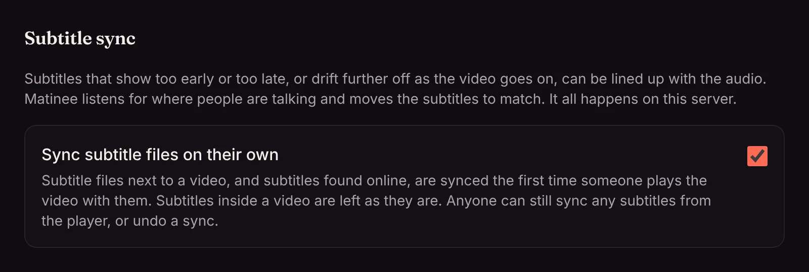

Subtitles made for another copy of a film are often out of step with yours: every line comes two seconds late because your copy has a shorter studio logo, or the lines drift further off as the film goes on because they were timed for a version that runs at another speed (European TV and DVDs play films about 4% faster). Matinee fixes both by listening. It finds where people are talking in the video and moves the subtitles until they line up with the speech.

## It happens on its own

Subtitle files next to your videos, and subtitles you [found online](/docs/watching/finding-subtitles/), are synced the first time someone plays the video with them. You don't have to do anything: a minute or two in, the player quietly switches to the fixed times and says **Subtitles synced to the audio**. From then on they play in step for everyone, on every device.

Subtitles inside the video file are left as they are, since they almost always match their video. If a video has text subtitles inside it, Matinee uses those as the guide for subtitle files in other languages, which is even more exact than listening.

An admin can turn the automatic part off under **Settings → Content → Subtitle sync**. **Sync to audio** in the player works either way.

## Sync to audio in the player

Open the subtitles menu while subtitles show and press **Sync to audio**, below **Timing**. Matinee listens to the video and lines the subtitles up, usually in well under a minute. The menu then says what it did:

- **Moved 2.4 s earlier** (or later): the subtitles were that far off, and now aren't.
- **Speed fixed**: the subtitles were timed for a version at another speed, so they now stretch or shrink to match the film, as well as move.
- **Already in sync**: nothing needed fixing.
- **Couldn't tell how far off these are**: no fit stood out clearly, so the subtitles stay as they were. This happens with subtitles for a different cut of the film, or a video with very little talking. Use **Timing** to move them by hand.

**Undo** puts the subtitles back the way the file has them, and Matinee won't sync them on its own again unless the file changes. **Sync again** listens once more.

A sync also clears any **Timing** you set by hand for that title, since the new times replace it. You can still nudge them with **Timing** afterwards.

In the [phone and TV apps](/docs/apps/phone-and-tv/) (from version 1.0.27), **Sync to audio** is in the player's subtitles menu too, below **Timing**.

Kids profiles can't sync or undo, but they see subtitles that someone else synced.

## How it works

Matinee does all of this on your server; nothing is sent anywhere.

1. It listens to the dialogue. For films with surround sound it listens to the center channel, where the voices are. For a long film it listens to three stretches spread over it rather than the whole thing, which is enough and much quicker on a network share.
2. It reads where each subtitle line starts and ends, leaving out lines that only describe sounds, such as *[door slams]* or *♪ ♪*.
3. It tries every shift up to 15 minutes either way, at the film's own speed and at the usual other speeds (23.976, 24 and 25 frames a second), and keeps the one where the lines fall on the talking best. It only changes anything when that fit clearly stands out.

What Matinee hears is kept, so the other subtitles of the same video sync in a moment. The subtitle files themselves are never changed: Matinee keeps the fix and applies it as it sends the subtitles to the player, so your media folders stay as they are, even when they're read-only.

Picture subtitles from Blu-rays and DVDs can't be synced this way. Use **Timing** for those, or find text subtitles for the film.
