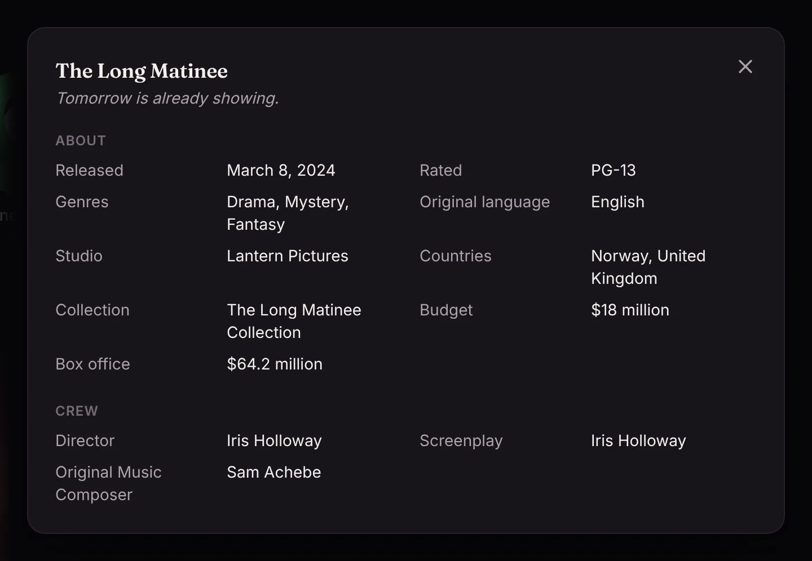
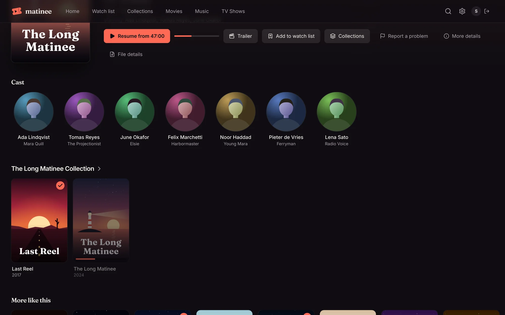
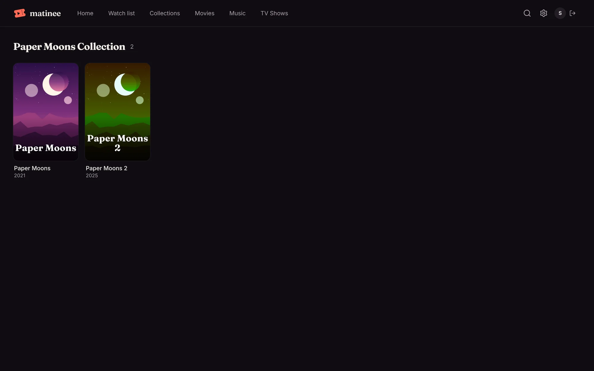
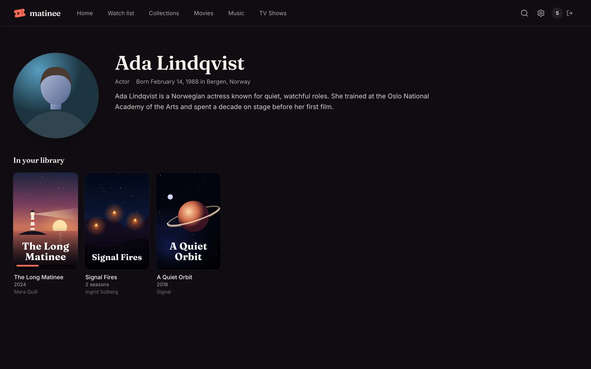
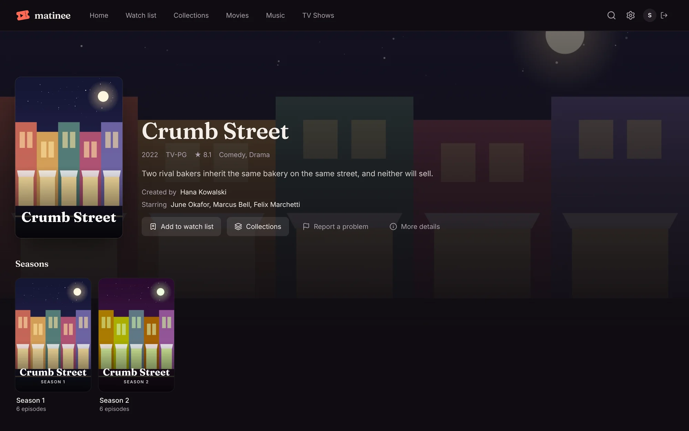
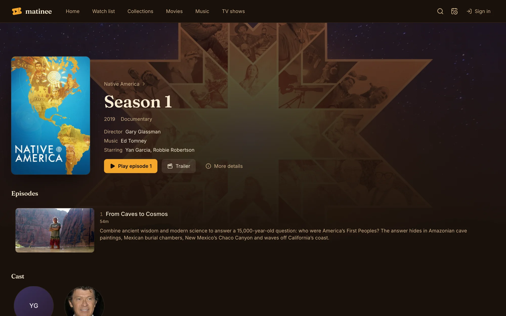
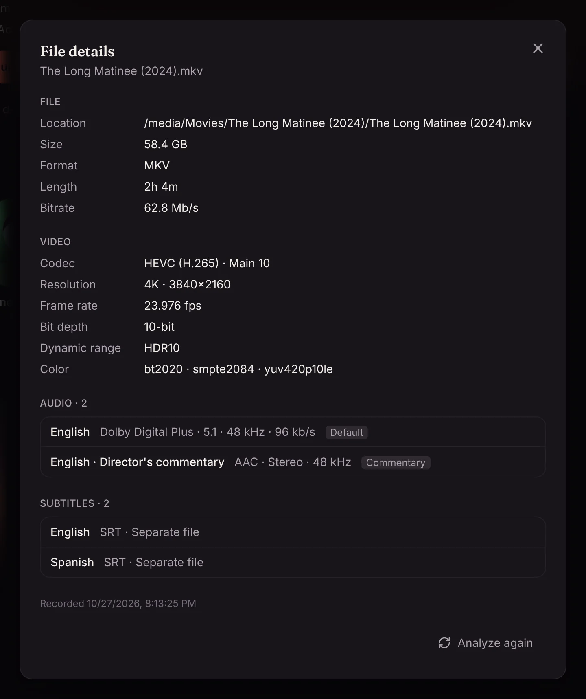
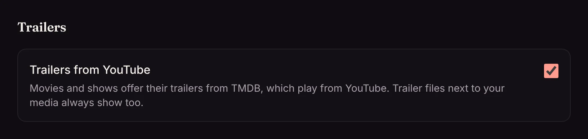

Click any poster to open its page. Everything Matinee knows about the title is here.

## At the top

- **The basics:** year, age rating, length, TMDB's rating and genres.
- **Badges** for the picture and sound, from [media analysis](/docs/server/media-analysis/): 4K, HDR10, Dolby Vision, Dolby Atmos, 5.1 and so on.
- **Audio and subtitle languages** in the file.
- **Tagline, description, director, writers, music and the main cast.** Click a name to see their [page](#people).

## The buttons

| Button | What it does |
| --- | --- |
| **Play** or **Resume from 47:00** | Starts playing, or picks up where you stopped. The bar next to it shows how far you got. |
| **Trailer** | Plays a trailer: one of your own trailer files, or one from YouTube via TMDB. Shown when there is one. |
| **Add to watch list** | Saves it to your [watch list](/docs/watching/watch-list/). |
| **Collections** | Adds it to (or takes it out of) one of your [collections](/docs/watching/collections/). |
| **Report a problem** | Tells an admin what's wrong: the picture, the sound, the subtitles, or the wrong title. Admins find reports under **Requests** (the inbox icon). |
| **More details** | Release date, studio, countries, budget and box office, awards, and the full crew. |
| **File details** | Everything about the file itself: see [File details](#file-details). |

## Cast, box sets and more like this

Further down are the cast, with their photos and the parts they played, then the title's **box set** (a trilogy or a series of films, from TMDB) if it has one, and **More like this**: titles in your library that TMDB links to it, or that share its genres and keywords.

Click a box set's name to see all its films, including where you are in the series.

## People

Every name links to a page with the person's photo, a short biography, and everything in your library they're in, with the part they played.

## Shows, seasons and episodes

A show's page has the same details plus its **seasons**. **Play** (or **Resume episode 3**) always starts the next episode you haven't finished.

A season lists its episodes with a still, the length, a short description, and a tick for each one you've watched.

## File details

**File details** shows what's in the file: where it is on the server, its size and format, and each video, audio and subtitle track, with codecs, resolution, HDR, channels and languages.

An admin can click **Analyze again** after changing a file in place. Normally Matinee notices changes by itself.

## Trailers from YouTube

Trailers from TMDB play from YouTube. An admin who'd rather not offer them can turn off **Settings → Trailers → Trailers from YouTube**; trailer files next to your media always show.

