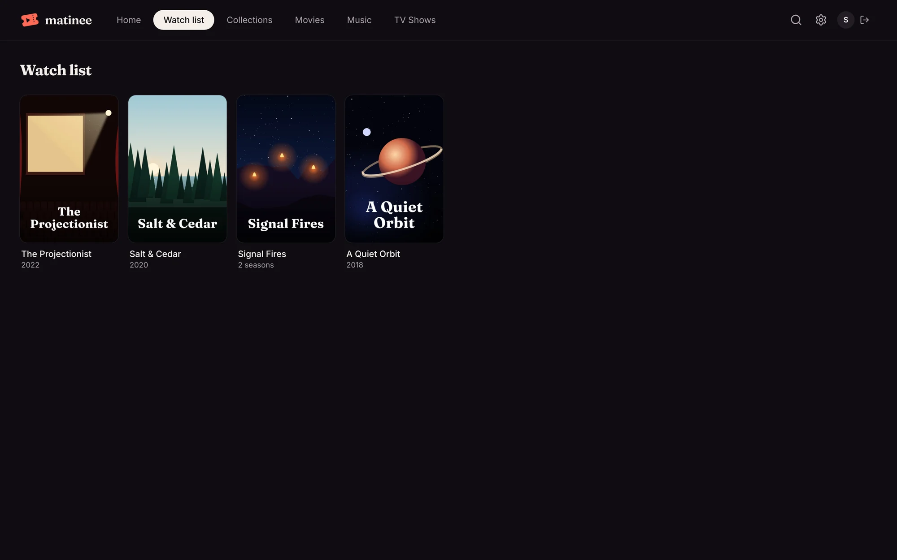

Found something for later? Click **Add to watch list** on its page. It turns into **On your watch list**; click again to take it off.

Your watch list is in the top bar (under **Libraries** on a phone) and as a row on [Home](/docs/watching/home/). It belongs to you (or your [profile](/docs/household/profiles/)), and it's the same in the browser and the apps. On an Apple TV it also shows in the top shelf above Matinee's icon.

A title stays on the list until you take it off, so finishing a film doesn't remove it. To see only what's on your list while browsing, use **Filters → Watched → Only titles on my watch list**.

Movies and shows go on the watch list. To keep an episode for later, add its show.
